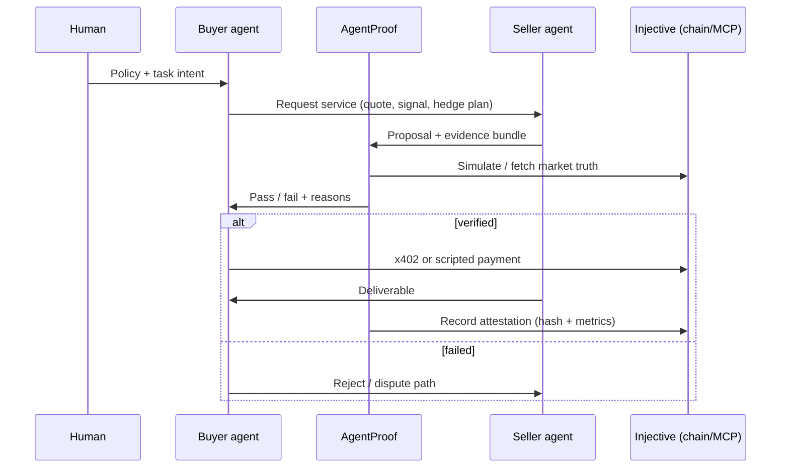

# AgentProof — brainstorm (no implementation yet)

**One-liner:** Verification layer for **agent-to-agent financial workflows** on Injective — identity is not enough; prove delivery, intent, and outcome before money moves.

Aligns with gap **#1** in [docs/LANDSCAPE.md](../docs/LANDSCAPE.md): identity exists; **verifiable execution** does not. Registry (ERC-8004), MCP, RFQ, AuthZ — **not** another marketplace or NEAR Intents clone.

**Hacker House note:** [LANDSCAPE.md](../docs/LANDSCAPE.md) ranks **IntentGuard** and **OptionLens** as mapping slightly cleaner to *live* primitives; AgentProof stays strong if the MVP stays **oracle-grounded checks + signed deliverable hashes** (skip TEE/ZK in week one).

---

## Problem statement

| Actor | Pain |
|-------|------|
| **Buyer agent** | Pays for “alpha” or execution help; cannot tell if provider is competent or honest |
| **Human operator** | Delegates to an agent; sees a tx succeeded but not whether it matched **stated intent** |
| **Ecosystem** | Registry lists 900+ agents; reputation alone does not prove **measurable deliverables** |

**Failure modes**

1. Provider returns stale or hallucinated market data after payment.
2. Executor agent trades different size/side/market than the user’s policy.
3. Multi-step workflow fails mid-flight; no shared audit trail across agents.
4. x402 payment settles before deliverable is validated.

---

## What Injective already gives you (build *on*, not *over*)

| Building block | Use in AgentProof |
|----------------|-------------------|
| Agent registry | Resolve provider identity, capabilities, payment address |
| Trading / market MCP | Ground truth prices, positions, simulation |
| Transaction simulation | Pre-flight “what will happen” |
| x402 / agent commerce | Pay only after verification gate (design target) |
| Injective Options / SICI (optional) | Rich demo narrative for “financial deliverable” |

**Do not build:** agent directory, generic MCP wrapper, “another trading bot.”

---

## Product shape (conceptual)

### Verification types (MVP pick 1–2)

| Type | Input | Check | Demo value |
|------|-------|-------|------------|
| **Data deliverable** | JSON report + cited symbols | Prices within ε of oracle at time T | Easy, no trading |
| **Trade intent** | Declared intent struct | Simulation outcome matches policy bounds | Strong Injective fit |
| **Service SLA** | Timestamped response | Latency + schema validity | Weaker alone |

**Recommended MVP:** **Data deliverable verification** + optional **simulated trade intent** (no live trades in v0).

---

## MVP scope (Builder House–friendly)

### In scope

- Intent schema (JSON): task type, symbols, max notional, allowed markets, expiry.
- Provider response schema: claims + evidence (API responses, hashes).
- Verifier module:
  - Pull `market_price` / indexer data via MCP or SDK.
  - Compare claims; emit pass/fail + diff.
- Minimal UI or CLI: run scenario from `scenarios/` fixtures.
- Optional: anchor attestation hash onchain (later week — not day 1).

### Out of scope (v0)

- Full dispute arbitration DAO.
- Replacing ERC-8004 reputation.
- Mainnet funds or live agent payments.
- Multi-chain solver (NEAR-style intents).

### Definition of done (demo)

1. Show **two registered-style agent personas** (can be mocked IDs).
2. Seller submits a deliberately **wrong** BTC price → AgentProof **fails**.
3. Seller submits correct data → **pass** → (mock) payment unlock.
4. Narrate how this composes with Injective Agents + x402 on mainnet later.

---

## Differentiation vs competitors

| Alternative | AgentProof angle |
|-------------|------------------|
| ERC-8004 registry | Registry = who; AgentProof = **what they delivered** |
| Agent402 / marketplaces | Discovery + pay; not **cryptographic / metric verification** |
| Wallet spend limits | Limits amount; not **semantic intent** |
| IntentGuard (sibling idea) | Focus **user→agent** policy; AgentProof focus **agent→agent** deliverables |

You can **merge** later: IntentGuard gates outbound txs; AgentProof gates inbound trust.

---

## Technical spikes (before coding)

| Spike | Question | Pass criterion |
|-------|----------|----------------|
| Registry API | Can we read agent metadata on testnet? | Sample agent record in notebook |
| Simulation | Does SDK/MCP expose sim for a sample trade? | One sim call documented |
| x402 | What is actually live vs announced? | Written “live / beta / roadmap” table |
| Attestation | Cheapest onchain record (memo / contract)? | Gas estimate on testnet |
| agent-sdk | Packaging, IPFS/Pinata deps for registry metadata? | Document workarounds for demo |
| RFQ overlap | Does “signed intent” in RFQ already cover your trade-intent checks? | Scope AgentProof to *data* deliverables if yes |

Track results in `brainstorm/spikes.md` (create when you start spikes).

---

## Risks and mitigations

| Risk | Mitigation |
|------|------------|
| “Just reputation” objection | Ship **quantitative** checks (price epsilon, sim mismatch) |
| Thin MVP | One killer demo script + screenshot, not 5 features |
| MCP signing accidents | Testnet only; no keystore in CI |
| Overlap with Injective roadmap | Position as **composable verification SDK**, pitch partnership |

---

## Judging narrative (60 seconds)

1. **Problem:** Financial agents can trade on Injective but users cannot trust agent-to-agent services.
2. **Insight:** Identity and payment rails exist; **verification** does not.
3. **Solution:** AgentProof — policy + oracle-grounded checks before settlement.
4. **Why Injective:** Registry, exchange simulation, MCP, agent commerce in one stack.
5. **Next:** Live x402 hook + onchain attestation + IntentGuard integration.

---

## Forks (if AgentProof feels heavy)

| Idea | When to switch |
|------|----------------|
| **IntentGuard** | You care more about **user policy** on outbound agent txs |
| **OptionLens** | You want **options testnet** demo (SICI, collateral UX) |
| **Cross-layer ops** | You are infra-minded (RPC + relayer incident story) |

Add sibling docs under `brainstorm/` if you pivot.

---

## Open decisions (for you)

1. Mock agents only vs real registry entries on testnet?
2. CLI-only demo vs minimal React dashboard?
3. Onchain attestation in MVP or post-hackathon?
4. Team strength: ML/agents vs trading vs frontend?

**Suggested default:** mock agents + CLI verifier + one slick recorded demo.
