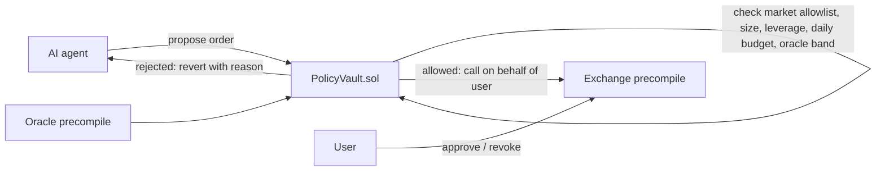

# IntentGuard — deep brainstorm (no implementation yet)

**One-liner:** Parameter-level, human-readable policies for AI trading agents on Injective — "Zodiac Roles for Injective's native exchange."

Maps to gap **#2** (policy UX) and **#6** (trust / over-broad grants) in [docs/LANDSCAPE.md](../docs/LANDSCAPE.md).

---

## 1. The real problem (verified, not hypothetical)

Today's official autosign path (`authz_grant` in `vendor/mcp-server/src/authz/index.ts`, `injective-trading-autosign` skill) issues a **`GenericAuthorization` per message type** with an expiry. That is the entire policy.

What a session key holding `MsgCreateDerivativeMarketOrder` can do:

| Can do | Why it matters |
|--------|----------------|
| Trade **any** of ~354 mainnet perp markets | Agent confuses `SICI` with an illiquid market; nothing stops it |
| Any **size** up to subaccount balance | Hallucinated "10x" or extra zero goes through |
| Any **leverage** up to market max | Same |
| Any **price** (market order slippage) on thin books | See attack below |
| Unlimited **number** of trades | Fee churn, revenge-trading loops |

The skill's security claim is "trading only, no withdrawals." **No withdrawals ≠ no loss.**

**Concrete attack (pitch this):** attacker steals a session key (or prompt-injects the agent) → places resting orders on an illiquid market from their own account → uses the grantee to market-buy into those orders at absurd prices → value moves to the attacker without a single `MsgSend`.

Prompt injection makes this realistic: agents read news, tweets, and docs. One poisoned input — "BREAKING: max long X now" — and a generic grant executes it.

---

## 2. Design principles

1. **Hard limits on-chain, soft judgement off-chain.** Anything that protects funds must not depend on IntentGuard's server being honest.
2. **Always allow de-risking.** Closing/reducing positions and cancels are never blocked by budget rules (a guard that traps you in a losing position is worse than none).
3. **Policies are readable both ways.** English → policy JSON → English again; the user signs what they read.
4. **Every decision has a reason.** `REJECTED: leverage 8.0x > policy max 3x` — logged, shown, and fed back to the agent so it can self-correct.
5. **Revocation is one click and verified on-chain** (skill rule: broadcast revoke, confirm, *then* clear local state).

---

## 3. Architecture options

### Option B — On-chain policy vault (recommended target)

Uses the **EVM exchange precompile proxy mode** ([docs](https://docs.injective.network/developers-evm/exchange-precompile#calling-the-precompile-direct-vs-proxy-access)):

```solidity
// user, once, from their EVM wallet
exchange.approve(policyVault, msgTypes, spendLimit, duration);
```



On-chain checks (cheap, deterministic):

| Rule | Data source |
|------|-------------|
| Market allowlist | `mapping(bytes32 => bool)` |
| Max margin per order | order params |
| Max leverage | notional ÷ margin |
| Daily budget (margin deployed) | rolling counter in vault state |
| Price band vs oracle (e.g. ±1%) | oracle precompile |
| Max orders per hour | counter |
| Policy expiry | timestamp |
| Reduce-only always allowed | position direction check |

Plus precompile-level `spendLimit` + `duration` as a second fence.

**Pros:** non-custodial, verifiable, works with *any* agent. **Cons:** Solidity + precompile semantics need a spike; testnet market set is limited.

### Option A — Off-chain co-signer (fallback)

IntentGuard service holds the session/grantee key; agents submit intents; service evaluates policy, simulates, then signs `MsgExec`. Supports rich rules (drawdown, volatility, correlation), but it is **custodial of the session key** — say that honestly in the pitch.

### Recommended: B for hard limits, A-style layer for soft rules + UX

Soft rules (warn/require human approval rather than block): "position > 20% of portfolio", "trading during funding spike", "market moved >5% in 10 min".

---

## 4. Product surface

| Component | What it is | Demo value |
|-----------|-----------|------------|
| **Grant Auditor** | Scan any `inj1…` for existing AuthZ grants; score risk (generic `MsgSend`, no expiry, `MsgBatchUpdateOrders`, stale grantees); one-click revoke | High, cheap, standalone — "revoke.cash for Injective AuthZ" |
| **Policy Composer** | English → policy JSON → rendered summary; diff before signing | High — the "wow" for non-devs |
| **PolicyVault** | Solidity contract enforcing hard limits via precompile | Core technical credibility |
| **IntentGuard MCP** | Tools: `get_policy`, `propose_order`, `remaining_budget`, `explain_rejection` — agents trade *through* the guard instead of raw trading MCP | Agent-native; plugs into Claude/Cursor today |
| **Decision log + kill switch** | Timeline of allowed/rejected actions with reasons; revoke all | Trust UX |

Example policy (what the user writes):

> "Trade only BTC and ETH perps. Max $200 margin per trade, max 3x leverage, $500 total per day. Never trade more than 1% away from the oracle price. Always let me close positions. Expires Friday."

Compiled (sketch):

```json
{
  "version": 1,
  "markets": ["BTC/USDT PERP", "ETH/USDT PERP"],
  "maxMarginPerOrder": "200",
  "maxLeverage": "3",
  "dailyMarginBudget": "500",
  "oracleBandBps": 100,
  "reduceOnlyAlwaysAllowed": true,
  "expiresAt": "2026-11-13T23:59:59Z"
}
```

---

## 5. Demo script (≈3 minutes)

Testnet has **18 active perps** (BTC/ETH/GOLD etc.; **no SICI**) — demo on those.

1. **Audit:** paste a wallet → IntentGuard flags a never-expiring generic grant to an old bot → revoke on-chain, confirmed.
2. **Compose:** type the policy above → see compiled JSON + plain-English echo → approve PolicyVault.
3. **Happy path:** Claude (via IntentGuard MCP) — "long ETH $100 at 2x" → allowed → fills on testnet.
4. **Prompt injection:** feed the agent a poisoned "news" snippet → it tries "long ETH $2,000 at 10x" → **rejected on-chain** with reason → agent reads `explain_rejection`, downsizes or stops.
5. **Thin-book attack:** grantee tries a market not on the allowlist → revert.
6. **Kill switch:** revoke → next agent call fails cleanly.

---

## 6. Competitive landscape

| Product | Chain | Gap IntentGuard fills |
|---------|-------|------------------------|
| Injective autosign (official) | Injective | Message-type only; no params |
| Zodiac Roles Modifier (Safe) | EVM | Not wired to Injective's native exchange module |
| MetaMask Delegation Toolkit (ERC-7710/7715 caveats) | EVM | Same; generic EVM calls, not orderbook semantics |
| Turnkey / Privy policy engines | Multi | Custodial key policies, not trading-aware (leverage, oracle band) |
| Coinbase AgentKit spend permissions | Base | Spend caps, not derivatives risk |

Positioning: **trading-semantic policies** (market, leverage, oracle band) on a **native orderbook**, enforced **on-chain**.

---

## 7. Technical spikes (day 1 — decide A vs B)

| # | Spike | Pass criterion |
|---|-------|----------------|
| 1 | Precompile `approve` from a testnet EVM wallet to a deployed contract | Contract places a derivative limit order for the user |
| 2 | `spendLimit` semantics | Know whether it caps per-message, total, or both |
| 3 | Oracle precompile read for a testnet perp | Price available in Solidity within one call |
| 4 | Query existing grants for an address (LCD `/cosmos/authz/v1beta1/grants/granter/{addr}`) | Auditor data path works |
| 5 | Reduce-only detection | Can read position direction in-contract or pre-check off-chain |

If spike 1 fails by end of day 1 → ship **Option A** (co-signer) + Auditor, and present B as the roadmap.

---

## 8. Risks

| Risk | Mitigation |
|------|------------|
| Precompile proxy flow buggy on testnet | Option A fallback; Auditor is useful regardless |
| "Just a wrapper on AuthZ" objection | Lead with the thin-book / prompt-injection attack — the generic grant demonstrably fails |
| EIP-712 / SDK version traps | Pin `@injectivelabs/sdk-ts` 1.17.8 per autosign skill |
| Policy compiler mistranslation | Always render back to English; user signs the rendered text |
| Scope creep (drawdown, ML risk) | Hard limits only for MVP; soft rules = warnings |

---

## 9. Pitch (60 seconds)

1. Injective lets AI agents trade natively — via autosign grants that only say *which message types*.
2. That means a session key can trade any market, any size, at any price. "No withdrawals" isn't "no loss" — here's a thin-book drain and a prompt injection doing it.
3. IntentGuard: write the policy in English, enforce it on-chain through the exchange precompile, give agents a guard-aware MCP.
4. Live: the injected agent gets rejected with a reason, and the human kills the session in one click.
5. Next: policy templates for funds, Injective Hub integration, AgentProof-style attestations of every decision.

---

## 10. Open decisions

1. Option B (on-chain vault) vs A (co-signer) — decided by spike 1.
2. Ship Grant Auditor as a public tool regardless? (recommended: yes)
3. Natural-language compiler: LLM-only vs template + LLM fill?
4. Frontend: Next.js dashboard vs CLI + MCP only?
