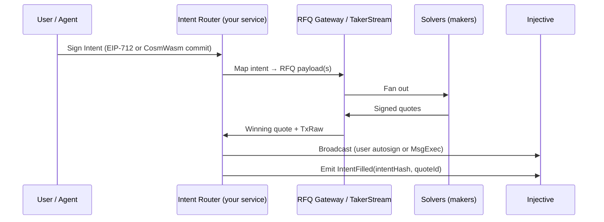
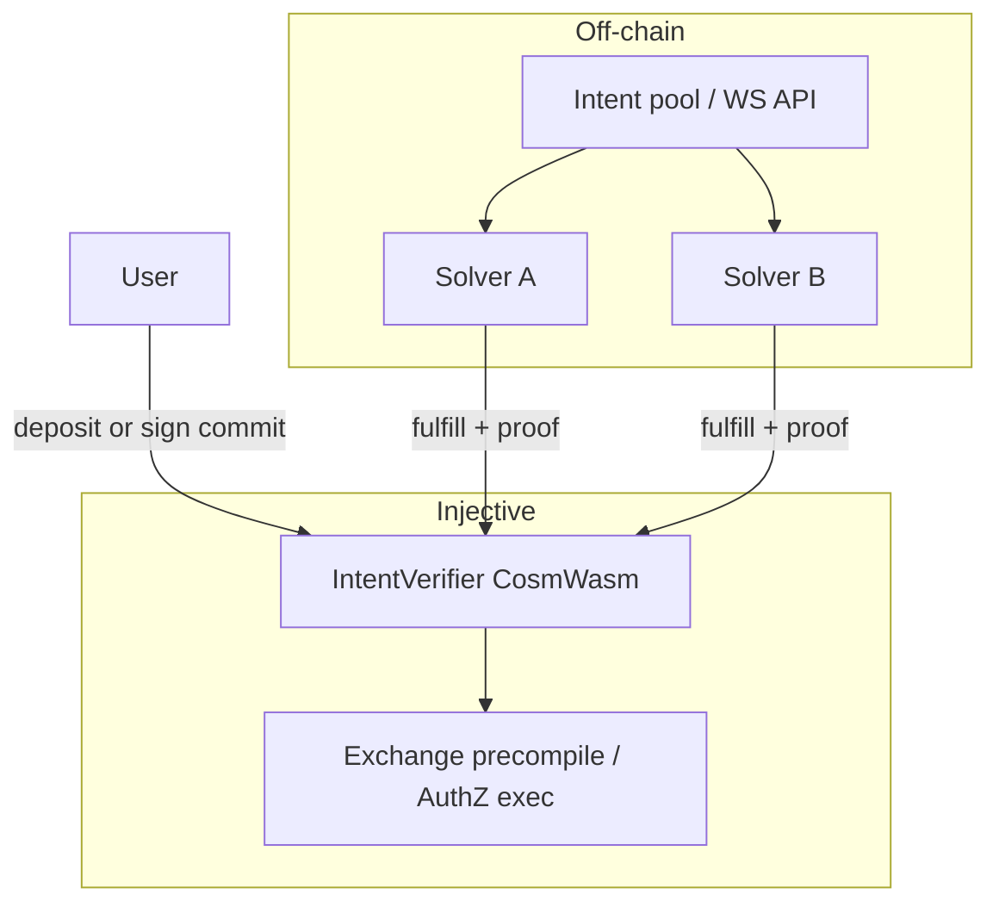

# Building NEAR-style intents on Injective

**Purpose:** How you *could* build a general **declare outcome → solvers compete → atomic settle** layer on Injective — honestly scoped for hackathon vs production.

**Not implemented.** Read with [LANDSCAPE.md §3](../docs/LANDSCAPE.md#3-near-intents-counterpart) and RFQ skill `references/architecture.md`.

---

## 1. What NEAR Intents actually is

| Layer | NEAR (simplified) |
|-------|-------------------|
| **User** | Signs or deposits against an **outcome** (e.g. exact-input swap, origin asset → destination asset on another chain). |
| **Intents bus / API** | [1Click](https://docs.near-intents.org/) — quote, deposit, status; solvers see open intents. |
| **Solvers (market makers)** | Compete on price and route; fulfill from inventory or bridge paths. |
| **Verifier** | On-chain contract enforces: if solver delivers `token_diff` matching intent, they get paid; else revert. |
| **Settlement** | **Atomic** where possible; cross-chain via NEAR’s abstraction + partner bridges. |

Key idea: user specifies **desired balances after**, not **which txs to run**.

---

## 2. What Injective already has (don’t rebuild)

| Primitive | Role today | “Intent-like”? |
|-----------|------------|----------------|
| **[INJ RFQ](https://rfq.inj.so/onboarding.html)** | Off-chain quote race → signed quotes → `accept_signed_intent` / gateway `TxRaw` | **Yes for derivatives RFQ** — competitive solvers (makers), user outcome = “open/close this perp size at ≤ worst price.” |
| **RFQ TP/SL** | User signs `SignedTakerIntent`; indexer watches mark; triggers quote + settle | **Conditional intent** — not general swaps. |
| **Exchange CLOB** | Spot/perps/options | Execution engine, not intent matching. |
| **Spot BUY/SELL_ATOMIC** | Instant spot, bypasses FBA | **Single-leg atomic** on Injective — useful inside a verifier. |
| **MsgBatchUpdateOrders** | Many creates/cancels in one tx | **Multi-leg same-chain** batch, not cross-chain. |
| **AuthZ + MsgExec** | Delegate specific msg types | Fulfillment path for an agent/solver key. |
| **Exchange precompile `approve`** | EVM policy + act on behalf | Solver contract can execute if user pre-authorized. |
| **CCTP, deBridge, Peggy, IBC** | Move assets | **Bridges**, not coordinated intent settlement. |
| **x402** | Pay for API | **Agent commerce**, not swap intents. |

**Closest existing pattern:** RFQ open/close (gateway fan-out, 500ms quote window, best quote wins, one chain tx). That is **80% of the solver auction** for one product vertical.

**Missing vs NEAR:** generic **asset graph**, **cross-chain outcome** standard, **public verifier contract** for arbitrary diffs, **open solver registry** for non-RFQ intents.

---

## 3. Architecture options (pick one thesis)

### Option A — **“RFQ generalization”** (best fit to Injective, medium risk)

Extend the **mental model** of RFQ to more outcome types without replacing the gateway.



**Intent types v0 (all mappable to live Injective):**

1. **Perp open/close** — existing RFQ autosign path.
2. **Spot atomic** — map “USDC → INJ” to `MsgCreateSpotMarketOrder` atomic or precompile swap path.
3. **Conditional exit** — reuse TP/SL signed taker intent.

**You build:** intent **schema**, **router** that translates outcome → RFQ/SDK calls, **solver dashboard** (register maker pubkeys), **indexer** of filled intents (read-only).  
**You don’t build:** new matching engine.

**Pros:** Demo in a week; uses `injective-rfq-integrations` skill.  
**Cons:** Not “any chain”; still trading-shaped.

---

### Option B — **On-chain verifier (CosmWasm) + off-chain solver network** (NEAR-shaped, higher effort)

User locks funds or signs a **commitment hash**; solvers race off-chain; winner submits **one fulfillment tx** that the contract checks.



**Verifier responsibilities (MVP):**

1. Store `intentId → { deadline, maxSlippage, allowedTokens, outcomeHash }`.
2. Accept `Fulfill(intentId, solver, settlementProof)` once.
3. Verify solver signature + that resulting balances / position match `outcomeHash` (or call exchange simulation).
4. Pay solver fee from spread or protocol fee.

**Fulfillment execution paths on Injective:**

| Outcome | How to fulfill |
|---------|----------------|
| Spot trade | `BUY_ATOMIC` / `SELL_ATOMIC` via AuthZ `MsgExec` from user granter |
| Perp | RFQ accept or derivative market order via delegated key |
| Multi-leg same chain | Single `MsgBatchUpdateOrders` |
| “Swap + bridge out” | **Phase 2** — verifier triggers CCTP/deBridge after spot leg (hard) |

**Pros:** Honest “intent protocol” story; composable with **IntentGuard** (policy on what intents user may publish).  
**Cons:** Custom contract audit; simulation/oracle correctness; escrow liquidity for solvers.

---

### Option C — **Cross-chain intents** (NEAR parity — high risk, not hackathon-sized)

NEAR’s moat is **origin chain ≠ destination chain** with one user signature.

On Injective you’d need:

1. **Intent** that names e.g. `injective:usdc` → `ethereum:usdc` (or Solana INJ via Sunrise).
2. **Solvers** with inventory on both sides or CCTP/deBridge quoting.
3. **Verifier or coordinator** that ties **burn proof** (CCTP) to **credit on Injective** atomically — Injective has CCTP mint in MCP but not a unified intent verifier.

**Realistic phased approach:**

- **Phase 1:** Injective-only outcomes (Option A or B).
- **Phase 2:** “Bridge intent” = user locks on Injective → solver delivers on Ethereum via Peggy/deBridge (solver reputation + escrow).
- **Phase 3:** Integrate with external intent networks (e.g. LI.FI API as solver back-end) instead of inventing cross-chain verifier.

---

## 4. Recommended intent schema (Injective-flavored)

NEAR uses assets like `nep141:wrap.near`. Define something similar:

```json
{
  "version": 1,
  "chain_id": "injective-1",
  "deadline": "2026-11-09T12:00:00Z",
  "type": "exact_input",
  "origin": { "denom": "erc20:0x...", "amount": "1000000" },
  "destination": { "denom": "peggy0x...", "min_amount": "990000" },
  "constraints": {
    "max_slippage_bps": 50,
    "allowed_routes": ["spot_atomic", "rfq_perp", "precompile_swap"],
    "markets_allowlist": ["BTC/USDT PERP"]
  },
  "solver_fee_bps": 10,
  "policy_ref": "intentguard:policy-hash-abc"
}
```

User signs **EIP-712** (EVM wallet) or **Cosmos ADR-36** (Keplr). Hash stored on-chain or in indexer.

**`token_diff` view** (for verifier):

```json
{
  "injective1abc...": { "usdc": "+100", "inj": "-2.5" },
  "subaccount:0x...": { "btc_perp_size": "+0.01" }
}
```

Solvers quote: “I will produce this diff for fee X.”

---

## 5. Solver network (what you must design)

| Piece | NEAR | Your Injective equivalent |
|-------|------|---------------------------|
| Registration | MM onboarding, JWT on 1Click | RFQ maker registry (on-chain) + your **solver API key** |
| Discovery | `getTokens`, intent feed | WS: new intents; REST: poll |
| Quoting | POST `/quote` | Same: POST `/solve` → returns signed quote or calldata |
| Slashing | Protocol rules | **Start with reputation + stake in CosmWasm** (optional) |
| Identity | — | Tie to **ERC-8004** agent/solver profile |

**Hackathon shortcut:** 2–3 hardcoded solver bots + 1 human “solver” wallet.

---

## 6. MVP slices (timeboxed)

### 6.1 **InjIntent Router** (3–5 days) — recommended if you insist on “intents” at Hacker House

- CLI or MCP: `publish_intent`, `list_quotes`, `execute_best`
- Maps 2 intents: **spot USDC→INJ** (atomic), **perp open via RFQ**
- Uses existing gateway + MCP; no new contract
- **Demo:** two solvers, worse quote loses, user gets best fill

### 6.2 **Verifier v0** (1–2 weeks)

- CosmWasm: register intent, single fulfill, event `IntentFilled`
- Fulfill via **AuthZ MsgExec** with pre-approved msg types (narrow!)
- Pair with **IntentGuard** policy: only intents matching user policy hash get registered

### 6.3 **Cross-chain** (months)

- Do not scope for first ship; use **LI.FI / CCTP** as solver backends later

---

## 7. How this relates to your other ideas

| Product | Relationship |
|---------|----------------|
| **IntentGuard** | Policy on **which intents** user/agent may sign; verifier checks `policy_ref`. |
| **AgentProof** | Attest that solver’s quote matched post-trade settlement. |
| **OptionLens** | New intent type: “buy SICI capped call strike K” once options API is public. |
| **NEAR clone** | Options A+B are **partial**; full NEAR = Option C + years of liquidity. |

**Strategic pitch to Injective:** “We’re not replacing RFQ — we’re **unifying** RFQ, atomic spot, and (later) bridge routes behind one **intent API** for agents.”

---

## 8. Risks and blockers

| Risk | Mitigation |
|------|------------|
| RFQ gateway access / latency | Use managed gateway path from skill; client-side gateway only if needed |
| No atomic multi-hop cross-chain | Injective-only v0 |
| Verifier bugs = fund loss | Narrow msg types; caps; testnet; IntentGuard |
| Duplicate Injective roadmap | Position as **agent-facing intent API**, partner not competitor |
| Legal (swap routing) | Geek outcome types (hedge SICI perp) not generic securities routing |

---

## 9. Day-1 spikes

| # | Question | Pass |
|---|----------|------|
| 1 | Can you complete one RFQ open on testnet with gateway? | Tx hash |
| 2 | One spot atomic via SDK? | Tx hash |
| 3 | Does indexer expose `accept_signed_intent` / conditional APIs you can call? | Doc + sample |
| 4 | CosmWasm: can contract trigger `exchange` execute via privileged path or only user AuthZ? | Architecture note |
| 5 | Map one NEAR 1Click quote flow side-by-side with your RFQ flow | Table in `spikes.md` |

---

## 10. Honest recommendation

| Goal | Build |
|------|--------|
| **Win hackathon** | **IntentGuard** or **OptionLens** — live primitives |
| **Say “intents” without greenfield** | **Option A — InjIntent Router** on top of RFQ + atomic spot |
| **Protocol research / Series A story** | **Option B** verifier + solver network, Injective-only first |
| **Clone NEAR Intents** | **Option C** — only with Injective Labs partnership + bridge/solver partners |

Full NEAR-style **cross-chain** intent settlement is **not** a solo hackathon; **RFQ-shaped intent routing for agents** is.
