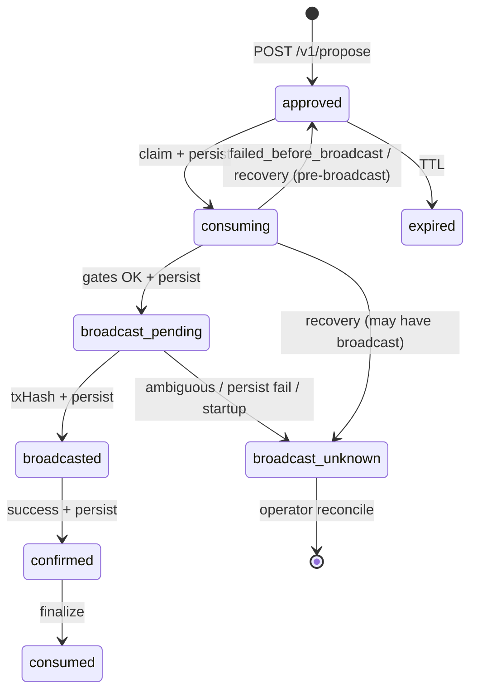

# IntentGuard execute safety (Phase 2A.3 / 2A.3.1)

Phase 2A.3 binds **propose → execute** and mandatory execute idempotency. **Phase 2A.3.1** adds **durable checkpoints before broadcast**, **startup recovery**, **revoke/execute coordination**, and **fail-closed AuthZ** for hosted testnet.

## Concurrency guarantee (read this first)

| Scope | Guaranteed? |
|-------|-------------|
| **Single Node.js process** | Yes — `AsyncLock` per `(sessionId, idempotencyKeyHash)` + `SessionExecutionGuard` per session |
| **Single Cloud Run instance** | Same as single process — service **`--max 1`** + revision **`--max-instances 1`** (see `scripts/lib/gateway-cloudrun-scale.sh`) |
| **Multiple replicas / revisions** | **No** — `state.json` on GCS FUSE is not distributed storage. Two processes can race. **Not multi-writer safe.** |

Cloud Run **revision** `max-instances` limits each template independently; **service** `--max` caps instances across the traffic split. Neither prevents overlapping revisions or tag URLs from mounting the same bucket — see [DEPLOY-GCP.md](./DEPLOY-GCP.md) § Single-Writer Guarantee.

## state.json mutations (maintenance does not block all)

| Operation | Persists? | Blocked by maintenance? |
|-----------|-----------|-------------------------|
| Startup `hydrate()` + recovery | Yes (post-recovery persist) | No |
| Session create / revoke | Yes | No |
| Owner key rotate | Yes | No |
| Agent propose | Yes | No |
| Execute lifecycle + idempotency | Yes (`persistNow` checkpoints) | **New executes only** |
| Maintenance reject audit | Yes | N/A |
| Shutdown handler | Yes | No |
| `GET /health`, read APIs | No state change | No |

`writeJsonAtomic` is process-local atomic replace, not cross-container locking.

## Persistence boundary (critical)

The orchestrator **`await persistNow()`** (HTTP `state.json` flush) at these checkpoints **before** continuing:

1. **After claim** — proposal `consuming` + idempotency `processing`
2. **After `broadcast_pending`** — proposal + idempotency both `broadcast_pending` (**must succeed before MsgExec**)
3. **After `txHash` known** — idempotency `broadcasted` (+ proposal `broadcasted`)
4. **After terminal outcome** — before HTTP response

If persistence fails at any checkpoint: **fail closed**, **no broadcast** (or `broadcast_unknown` if already past broadcast boundary).

`writeJsonAtomic` alone does not make the full claim→persist sequence atomic across crashes; the **checkpoints** define durability.

## State transition diagram



### Proposal statuses

`approved` | `consuming` | `broadcast_pending` | `broadcasted` | `broadcast_unknown` | `confirmed` | `consumed` | `failed_before_broadcast` | `expired` | `denied`

### Idempotency statuses

`processing` | `broadcast_pending` | `broadcasted` | `confirmed` | `completed` (legacy alias) | `failed_before_broadcast` | `broadcast_unknown`

## Startup recovery (single instance)

On gateway `hydrate()` → `recoverExecutionSafetyOnStartup()`:

| Persisted state | Behavior |
|-----------------|----------|
| `approved` | Remains executable if not expired |
| `consuming` + idempotency `processing` only | **Pre-broadcast** → proposal `approved`, idempotency `failed_before_broadcast` |
| `consuming` + idempotency ≥ `broadcast_pending` | → **`broadcast_unknown`** (never auto-rebroadcast) |
| `broadcast_pending` / `broadcasted` | → **`broadcast_unknown`** |
| `broadcast_unknown` | Unchanged; same idempotency key returns stored outcome |
| Terminal (`confirmed` / `completed` / `failed_before_broadcast`) | Idempotent replay |

Recovery metadata on records: `lastTransitionAt`, `recoveryAt`, `recoveryReason`, `previousState`.

**No age-based timeout** releases a proposal when a transaction may have been broadcast.

### Operator recovery (`broadcast_unknown`)

1. Inspect audit + idempotency record (`txHash` if present).
2. Query chain / indexer for the session grantee and intent.
3. If no tx landed, **do not** auto-reset — manual state repair or new session.
4. Never retry with a **new** `Idempotency-Key` on the same consumed proposal.

## Revocation race semantics

- **Before broadcast boundary:** `POST …/revoke` clears grantee key; pre-broadcast gates deny execute.
- **During `claimed` (not broadcasting):** Revoke wins; execute fails closed on session gate.
- **During `broadcasting`:** Revoke **still completes** (Phase 1.5 semantics unchanged) but **cannot cancel** an already-submitted chain tx. Audit event `revoke_during_broadcast`.

`SessionExecutionGuard` coordinates one in-flight execute per session in-process.

## On-chain AuthZ configuration

| Environment | Rule |
|-------------|------|
| Hosted (`DOCKER=1`, `INTENTGUARD_HOSTED=1`, or `NODE_ENV=production`) | `INTENTGUARD_REQUIRE_ONCHAIN_GRANT=0` → **startup error** unless `INTENTGUARD_ALLOW_AUTHZ_BYPASS=1` (local dev only) |
| Execute path | Re-verifies both typed grants (market, subaccount, msg types, expiry) when enabled |

## Policy fingerprint drift

At execute time:

1. Re-evaluate live policy (margin, leverage, daily budget, markets).
2. If **`policyFingerprint` ≠ proposal** → `409 policy_fingerprint_stale` (require new propose).
3. Stricter live policy without fingerprint change can still deny (`policy_denied`).

Harmless metadata not in the canonical fingerprint does not affect binding.

## Agent flow

1. `POST /v1/propose` → `proposalId`, `intentFingerprint`, `proposalExpiresAt`
2. `POST /v1/execute` with `Idempotency-Key` + matching `{ proposalId, intent }`
3. Safe retry: same key + payload → stored result (`idempotentReplay: true`)

## State Write Freeze and Cross-Revision Ownership

See mutation table above. **Execution maintenance** (`INTENTGUARD_EXECUTION_MAINTENANCE`) and **state write freeze** (`INTENTGUARD_STATE_WRITE_FREEZE` or owner `POST /v1/owner/state-write/freeze`) are separate:

| Mechanism | Blocks |
|-----------|--------|
| Execution maintenance | New `POST /v1/execute` (after early gates) |
| State write freeze | All persistent mutations (sessions, propose, revoke, execute checkpoints, recovery persist) |

Owner-only operator routes: `POST /v1/owner/state-write/freeze`, `unfreeze`, `GET /v1/owner/state-write/status`. Agent tokens cannot change freeze state.

**Writer lease** (optional): `INTENTGUARD_WRITER_LEASE_MODE=file` on hosted data dir stores `.writer-lease.json` with a **fencing token**. Before each `state.json` flush the gateway re-reads the lease; a stale process fails closed. This is **not** a full GCS generation precondition — overlapping FUSE writers can still race the lease file. Treat as **best-effort fencing** plus **serial rollout** (see [DEPLOY-GCP.md](./DEPLOY-GCP.md)).

**Proven in tests:** single-process freeze, freeze during active mutation, stale fencing rejection (file lease), owner-only freeze HTTP, shutdown flush while frozen.

**Not proven:** cross-process safety on GCS FUSE without operational single-writer handoff.

## Maintenance mode (deploy / rollback)

**Env:** `INTENTGUARD_EXECUTION_MAINTENANCE=1` (default **off** for local dev).

| When set on a gateway process | Behavior |
|-------------------------------|----------|
| New `POST /v1/execute` | **`503 execution_maintenance`** — audit `execute_maintenance_rejected` |
| Proposal claim / new idempotency `processing` | **Skipped** on early reject |
| After claim, before `broadcast_pending` | `failed_before_broadcast` + proposal released to `approved` |
| After broadcast boundary | **No** maintenance abort — chain tx may already be in flight |
| `GET /health`, propose, revoke, audit | Unchanged |

**Not** a distributed lock: each Cloud Run revision reads its own env. Overlapping revisions during deploy can have maintenance on one process only. Operators must enable maintenance on the **traffic-serving** revision before rollout and clear it only after the **new** revision is verified as sole writer.

## Testnet demo Cloud Run

- Gateway: **service `--min 1 --max 1`**, revision **`--min-instances 0 --max-instances 1`** (`scripts/deploy-intentguard-gcp.sh`). Web scales independently.
- Local script check: `bash scripts/validate-gateway-deploy.sh`
- Live read-only: `bash scripts/verify-gateway-cloudrun-live.sh`

- `INTENTGUARD_EXECUTE=1`, `INJECTIVE_NETWORK=testnet`
- Do **not** set `INTENTGUARD_REQUIRE_ONCHAIN_GRANT=0` or `INTENTGUARD_ALLOW_AUTHZ_BYPASS=1` on hosted runtimes

## Example

```bash
PROP=$(curl -sS -X POST "$BASE/v1/propose" \
  -H "Authorization: Bearer $AGT" -H "Content-Type: application/json" \
  -d '{"intent":{"marketId":"0x…","margin":"5","leverage":2,"price":"10","quantity":"1"}}')
PID=$(echo "$PROP" | jq -r .proposalId)

curl -sS -X POST "$BASE/v1/execute" \
  -H "Authorization: Bearer $AGT" \
  -H "Idempotency-Key: my-unique-key-1" \
  -H "Content-Type: application/json" \
  -d "{\"proposalId\":\"$PID\",\"intent\":{...same...}}"
```
