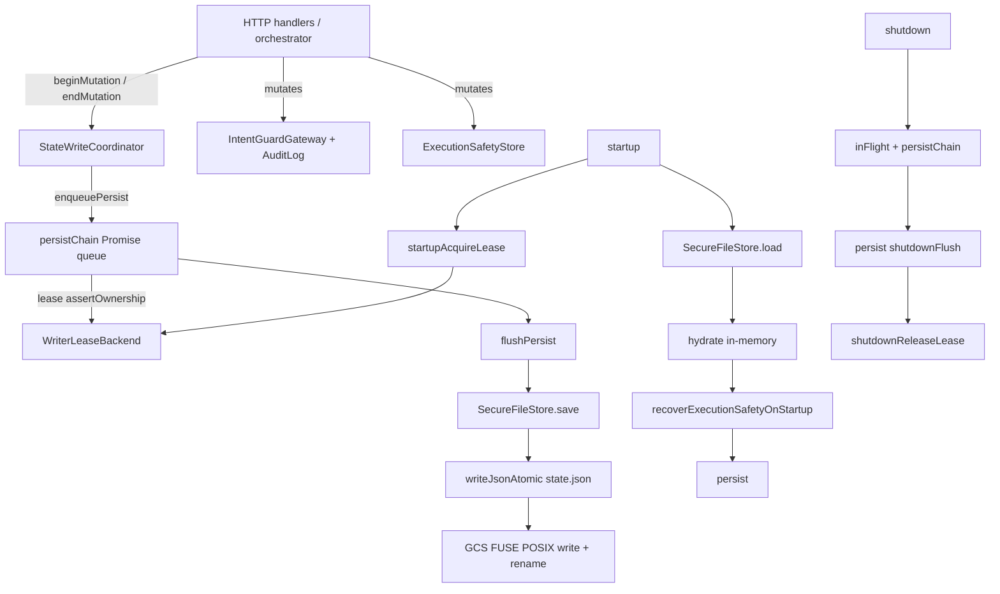
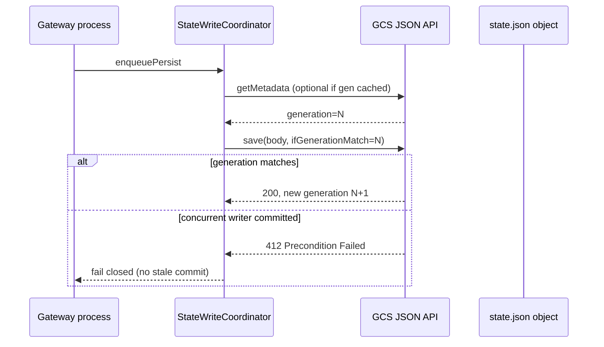

# IntentGuard — Native GCS Conditional Persistence (Design)

**Phase 2B.3.3 — research and design only.** No implementation in this document’s phase.

**Goal:** Determine whether native Google Cloud Storage (GCS) conditional operations can provide **genuine cross-process stale-writer rejection** while keeping the existing `state.json` schema and execution-safety model.

---

## 1. References (official)

| Topic | URL |
|-------|-----|
| Request preconditions | https://cloud.google.com/storage/docs/request-preconditions |
| Generation numbers | https://cloud.google.com/storage/docs/metadata#generation-number |
| Consistency | https://cloud.google.com/storage/docs/consistency |
| GCS FUSE overview | https://cloud.google.com/storage/docs/cloud-storage-fuse/overview |
| Node.js `File#save` | https://cloud.google.com/nodejs/docs/reference/storage/latest/storage/file |
| Conditional upload sample | https://cloud.google.com/storage/docs/samples/storage-upload-without-authentication |
| `googleapis/nodejs-storage` `PreconditionOptions` | https://github.com/googleapis/nodejs-storage/blob/main/src/storage.ts (exported type) |

---

## 2. Current architecture (as implemented)

### 2.1 Storage layout

| Path | Backend | Purpose |
|------|---------|---------|
| `{dataDir}/state.json` | GCS FUSE mount (`/data/.intentguard`) | Durable gateway state (v3 JSON) |
| `{dataDir}/.writer-lease.json` | Same mount (optional) | File-based lease + fencing token |
| `{dataDir}/config.json` | Local/FUSE | Owner API key (not in `state.json`) |

### 2.2 Persistence call graph



**Single disk entry point for `state.json`:** `SecureFileStore.save` → `writeJsonAtomic`.

**Bypasses:**

| Write | Bypasses `StateWriteCoordinator`? | Bypasses `state.json`? |
|-------|-----------------------------------|------------------------|
| `rotateOwnerApiKey` → `config.json` | No (HTTP uses `beginMutation` + `persist` for audit) | Yes — direct `writeFileSync` on `config.json` |
| `loadConfig` initial owner key creation | N/A (before server) | Yes — creates `config.json` |
| `platform-verify` CLI | N/A | Yes — test helper |
| In-memory `idempotencySet` (propose HTTP cache) | No durable write | N/A |

### 2.3 `writeJsonAtomic` behavior

1. Write `.{basename}.tmp` in the same directory as `state.json`.
2. `renameSync(tmp, path)` to replace `state.json`.

**Properties:** Atomic rename on a **single machine** against a **local or FUSE-backed path**. **No** generation preconditions. **No** cross-process serialization.

### 2.4 Full-state rewrite

Every `flushPersist()`:

1. `executionSafety.pruneOld(...)` (in-memory).
2. Exports sessions, audit, proposals, idempotency.
3. Serializes **entire** `PersistedStateV3` JSON and replaces the file.

There is **no** partial update or append-only log.

### 2.5 Persistence failure and memory divergence

| Failure point | Behavior |
|---------------|----------|
| `persist()` / `persistNow()` throws | Logged `persist_failed`; execute path returns `503` / `persist_failed` and aborts broadcast where orchestrator awaits `durablePersist` |
| HTTP handler after in-memory mutation | Client may see success while disk stale until `await persist()` — handlers increasingly `await persist()` |
| Concurrent processes | Each has its own in-memory state; last FUSE `rename` wins — **silent lost update** |

### 2.6 Startup ordering

1. `startupAcquireLease()` (if lease mode enabled).
2. `store.load()` (read full JSON).
3. Import sessions, audit, execution state.
4. If **not** state-write frozen: `recoverExecutionSafetyOnStartup` → `persist()`.

**Gap:** `load()` occurs **before** recovery but **after** lease acquire. Recovery can mutate and persist while another process could still hold an overlapping FUSE writer if lease is file-based only.

### 2.7 Shutdown

1. `shuttingDown` → reject new HTTP work.
2. `server.close` + wait `inFlight`.
3. `waitForPersistIdle()` + `persist({ shutdownFlush: true })` (skipped when state-write freeze is active).
4. `shutdownReleaseLease()`.

---

## 3. Native GCS conditional operations (findings)

### 3.1 Generation preconditions

| Mechanism | HTTP | Semantics |
|-----------|------|-----------|
| `ifGenerationMatch` | JSON query / `x-goog-if-generation-match` | Proceed only if live object **generation** equals value; else **412 Precondition Failed** |
| `ifGenerationNotMatch` | JSON query | Proceed only if generation differs; else **304** (reads) |
| `ifGenerationMatch: 0` | Special | Create-only: proceed only if **no live object** with that name |
| `ifMetagenerationMatch` | JSON query | Metadata generation — **must pair with `ifGenerationMatch` on objects** |

Object **replacement** on successful upload creates a **new generation number**. Failed precondition means **no commit**.

### 3.2 Node.js `@google-cloud/storage`

Documented pattern (Google sample):

```javascript
await file.save(contents, {
  preconditionOpts: { ifGenerationMatch: generationMatchPrecondition },
});
```

**Supported operations (representative):**

| Operation | Method | Precondition option |
|-----------|--------|---------------------|
| Read metadata + generation | `file.getMetadata()` | — returns `generation`, `metageneration` |
| Conditional upload/replace | `file.save(data, { preconditionOpts })` | `ifGenerationMatch`, `ifMetagenerationMatch` |
| Conditional upload/replace | `file.createWriteStream({ preconditionOpts })` | same (via `CreateWriteStreamOptions`) |
| Create if absent | `file.save(data, { preconditionOpts: { ifGenerationMatch: 0 } })` | |
| Conditional delete | `file.delete({ ifGenerationMatch })` | |
| Conditional move | `file.moveFileAtomic(dest, { preconditionOpts })` | |

**412 handling:** Rejected request; object unchanged. Client should **reload generation** or fail closed (IntentGuard should **not** blind-retry execute checkpoints).

**Metageneration:** Appropriate for **metadata-only** updates (ACL, custom metadata). **Not** a substitute for generation-match on **content** replacement of `state.json`.

### 3.3 GCS FUSE vs native API

| Question | Finding |
|----------|---------|
| Does FUSE expose `ifGenerationMatch` on `write()` / `rename()`? | **No.** POSIX writes do not accept GCS preconditions. |
| Can `writeJsonAtomic` enforce generation match? | **No**, while writing only through the mount. |
| Does FUSE rename equal conditional compose? | **No.** FUSE semantics differ from JSON API; not all POSIX operations are atomic relative to GCS generations (see [FUSE semantics](https://cloud.google.com/storage/docs/cloud-storage-fuse/overview)). |
| Can API write and FUSE read the same object? | **Read path:** yes (eventual consistency lag possible). **Write path:** **unsafe to mix** — FUSE write can overwrite API-conditional object without honoring prior generation the process tracked. |
| Recommended split | **Writes only via GCS API** for `state.json` (and lease object); FUSE optional for **read-only** cache or deprecated. |

---

## 4. Architecture options compared

### Option 1 — Conditional full-state replacement

**Mechanism:** Track `generation` from `file.getMetadata()` (or from prior successful save). On each persist, `file.save(body, { preconditionOpts: { ifGenerationMatch: expectedGen } })`. New object absent: use `0`.

| Criterion | Assessment |
|-----------|------------|
| Lost-update prevention | **Yes, at commit** — second writer with stale generation gets **412** |
| Stale paused process (Scenario B) | **Rejected at commit** if generation advanced |
| Lease alone required? | **No** for stale-write safety |
| Crash mid-upload | Client may not see response; next startup **`getMetadata`** establishes authoritative generation |
| Large JSON | Full rewrite each time (same as today); size limits (~tens of MB) acceptable for demo scale |
| In-memory on 412 | Must **fail closed** (reload or operator reconcile) — aligns with existing execute durability |

**Limitation:** Does **not** prevent two processes from **both** making **incorrect in-memory decisions** before either persists; it prevents **silent overwrite** of newer disk state.

### Option 2 — Dedicated GCS lease object only

**Mechanism:** Separate object `writer-lease.json` with conditional create (`ifGenerationMatch: 0`) or conditional update.

| Criterion | Assessment |
|-----------|------------|
| Can expired lease holder still write `state.json`? | **Yes**, unless `state.json` write is also conditional |
| Fencing token in lease file | **Not enforced** on state object without Option 1 or 3 |
| Crash / partition | Two holders possible if lease update is non-atomic or TTL-only without generation |

**Verdict:** **Insufficient alone** for the required property.

### Option 3 — GCS lease + conditional state persistence

**Mechanism:** Lease object for **operational visibility** + **conditional `state.json` save** with generation match. Optionally embed `writerEpoch` / `holderId` in JSON for audit (not authoritative).

| Race | Analysis |
|------|----------|
| Read lease → read state → write state | **Not atomic** between objects; stale writer still blocked on **state** `ifGenerationMatch` |
| Read state gen → pause → peer writes → resume | **412 on save** ✓ |

**Verdict:** **Smallest safe combination** — authoritative primitive is **conditional replace of `state.json`**; lease is optional operator UX.

### Option 4 — Transactional store (e.g. Firestore)

| Criterion | Assessment |
|-----------|------------|
| Atomic ownership + fence | Yes, via transactions |
| Material improvement over Option 3? | **Marginal** if state remains one JSON blob — still need transactional **read-modify-write** of large document or schema split |
| Cost / complexity | Higher; new IAM, backups, failure modes |
| Minimum scope if chosen | **Coordination only** (lease + epoch), state still in GCS with generation match — then Firestore adds little vs Option 3 |

**Verdict:** **Not recommended for v0.2** unless schema is split into small transactional records.

---

## 5. Concurrency scenarios (expected outcomes)

### Scenario A — Normal concurrent writes (both read generation 10)

| Step | Outcome |
|------|---------|
| A `save(..., ifGenerationMatch: 10)` | Success → generation **11** |
| B `save(..., ifGenerationMatch: 10)` | **412** — no overwrite |
| B recovery | Reload metadata (gen 11), merge policy: **fail closed** for execute or re-apply mutation on fresh snapshot |

### Scenario B — Stale process resumes

| Step | Outcome |
|------|---------|
| A held gen 10 in memory; B saves with match 10 → gen 11 | B succeeds |
| A resumes, saves with match 10 | **412** — **stale writer cannot commit** ✓ |

Pre-check “am I still owner?” without generation on the **upload request** does **not** satisfy the requirement; **`ifGenerationMatch` on upload** does.

### Scenario C — Lease renewal race

| Step | Outcome |
|------|---------|
| A and B conditional-update lease with generation match | One succeeds; other **412** if using generation correctly |
| TTL-only lease without generation | **Two owners possible** — avoid |

Use **conditional lease object updates**, not FUSE file lease.

### Scenario D — Crash during state persist

| Step | Outcome |
|------|---------|
| Upload completes, client crashes before ACK | Next process: `getMetadata` → gen advanced; memory must reload |
| Upload incomplete | Generation unchanged; retry with same `ifGenerationMatch` safe (idempotent replace) |

### Scenario E — Startup recovery overlap

| Step | Outcome |
|------|---------|
| A running, B starts | B loads gen N, recovers in memory, persist with match N |
| If A wrote in between | B gets **412**; B must not serve mutations until reload + recovery re-run or exit |

**Requirement:** Do not run overlapping writers operationally; conditional persist is backstop.

### Scenario F — Shutdown vs handoff

| Step | Outcome |
|------|---------|
| A shutdown flush with `ifGenerationMatch: g` | Succeeds only if still authoritative |
| B acquired and wrote gen g+1 | A’s final flush **412** — **correct** (A must not commit after handoff) |

Trade-off: A may exit without final flush — acceptable if B already loaded truth; operator uses freeze + drain.

---

## 6. Stale-writer safety — achievable?

| Layer | Provable stale-writer rejection at commit? |
|-------|--------------------------------------------|
| FUSE + `writeJsonAtomic` | **No** |
| File lease + pre-write assert | **No** (check-then-act gap) |
| GCS `ifGenerationMatch` on `state.json` upload | **Yes** (412 if generation advanced) |
| Lease-only (any storage) | **No** for `state.json` |
| Operational single writer | Reduces overlap; **not a proof** |

**Conclusion:** **Genuine cross-process stale-writer rejection is achievable** if and only if **all commits of `state.json` use native GCS uploads with `preconditionOpts.ifGenerationMatch`** (and FUSE is not used for writes to that object).

This is **not** proven by mocks alone; requires **real bucket integration tests**.

---

## 7. Implemented architecture (Phase 2B.3.4)

**Code:** `apps/intentguard/src/persistence/gcsConditionalStateStore.ts`, `gcsNodeAdapter.ts`, `gatewayStateStore.ts`.

1. **`GcsConditionalStateStore`** replaces authoritative write/read path of `SecureFileStore` when `INTENTGUARD_STATE_BACKEND=gcs`:
   - `load()`: `file.download()` or metadata + download (not FUSE write path).
   - `save()`: `file.save(json, { resumable: false, preconditionOpts: { ifGenerationMatch } })`.
   - In-memory `this.generation` updated only after successful save.
   - On **412**: throw `StateGenerationConflictError`; coordinator fails closed; execute must not broadcast past checkpoint.

2. **Keep:** `StateWriteCoordinator`, execution maintenance, state write freeze, schema v3, recovery rules (`broadcast_unknown`, no blind rebroadcast).

3. **Optional:** `intentguard/writer-lease.json` in same bucket via conditional create/update for health/ops (not authoritative for stale state writes).

4. **FUSE:** No authoritative `state.json` writes in hosted deploy (`deploy-intentguard-gcp.sh` sets GCS env). Mount kept for `config.json`.

5. **Fencing:** `writerEpoch`, `writerHolderId`, `lastCommitId` in v3 JSON **plus** `ifGenerationMatch` on every upload. Ownership takeover bumps epoch on first `save()` when `writerHolderId !== holderId`.

6. **Ambiguous upload:** On 412, reconcile via `lastCommitId` on downloaded object; no auto-reload+retry stale memory.

**Local dev:** `INTENTGUARD_STATE_BACKEND=file` (default) → `SecureFileStore` + `writeJsonAtomic`.

**Why not lease-only:** Expired lease does not block FUSE/API write without generation match on the state object.

---

## 8. Migration plan (future implementation)

| Phase | Action |
|-------|--------|
| M0 | `INTENTGUARD_STATE_BACKEND=gcs` vs `file` (dev) |
| M1 | Implement `GcsConditionalStateStore`; wire through `enqueuePersist` only |
| M2 | Hosted: disable FUSE write to `state.json` (API-only object path `intentguard/state.json` in bucket) |
| M3 | One-time: copy existing FUSE `state.json` to canonical object; record generation |
| M4 | Deploy **single** new revision with API backend; **no** overlapping old writer (freeze + serial handoff) |
| Rollback | Revert image only if generation-tracked file compatible — **never** two writers |

**In-flight execute / `broadcast_unknown`:** Unchanged recovery semantics; on 412 during checkpoint, surface `persist_failed` / conflict — operator reconcile.

**Backup/restore:** Export object + note generation; restore creates new object (gen 0 path) or conditional replace with explicit operator intent.

---

## 9. Test plan (pre-acceptance)

| # | Test | Layer |
|---|------|-------|
| 1 | Two concurrent conditional saves, stale gen → 412 | Real GCS integration |
| 2 | Stale generation write rejection | Real GCS + unit error mapping |
| 3 | Conditional lease create `ifGenerationMatch: 0` | Real GCS |
| 4 | Lease conditional update race | Real GCS |
| 5 | Stale process resume (simulated gen drift) | Integration |
| 6 | Crash after success before client ACK | Integration + metadata poll |
| 7 | Startup recovery with 412 on first persist | Unit + integration |
| 8 | Shutdown flush vs new owner 412 | Integration |
| 9 | Execute persist_failed on 412 before broadcast | Unit (existing pattern) |
| 10 | `broadcast_unknown` unchanged | Regression |
| 11 | Schema v3 unchanged | Unit |
| 12 | Dedicated test bucket, CI secret | Integration job |

**Mocks:** SDK mock for error mapping only — **not** proof of GCS behavior.

**Cloud Run:** Single-revision deploy test after API backend — operational, not substitute for §5 proofs.

---

## 10. Unresolved questions

1. **Read path:** Always API download vs FUSE read — consistency lag if mixed?
2. **Object path:** `intentguard/state.json` vs `.intentguard/state.json` — align with mount path for operator mental model.
3. **Generation reload policy:** On 412, automatic single reload+retry vs fail closed for execute (recommend **fail closed** for execute checkpoints).
4. **Resumable uploads:** Disable for small JSON (`resumable: false`) to simplify failure modes.
5. **IAM:** Cloud Run SA needs `storage.objects.create/update/get` on state + lease objects only.
6. **GCS FUSE on same object:** Confirm mount not configured for same key if API writes — or unmount state dir.
7. **Firestore:** Revisit only if proposal/idempotency split into row-level transactions.

---

## 11. Diagram — target write path



---

## 12. Phase 2B.3.4 status

| Item | Status |
|------|--------|
| `GcsConditionalStateStore` + node adapter | Implemented |
| Unit tests (memory adapter) | 197+ pass in gateway suite |
| Live GCS integration test | Gated: `INTENTGUARD_GCS_LIVE_TEST=1` + bucket — **not proof of prod** until run |
| FUSE authoritative writes removed (hosted) | Deploy env + `createGatewayStateStore` |
| Operator migration on live bucket | Documented only — **not executed** in repo agents |

Security review: [STATE-PERSISTENCE-GCS-SECURITY-REVIEW.md](./STATE-PERSISTENCE-GCS-SECURITY-REVIEW.md).
